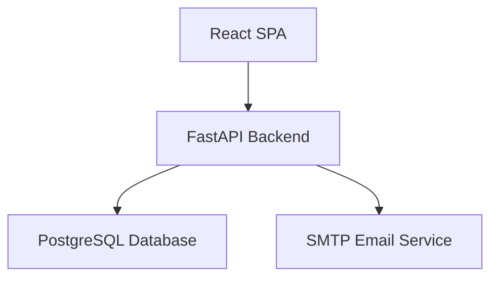
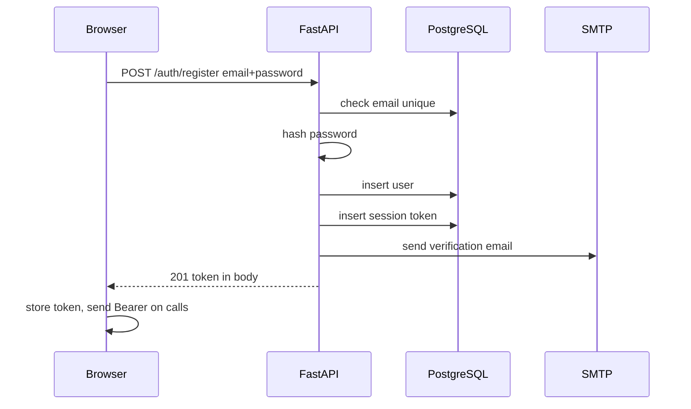
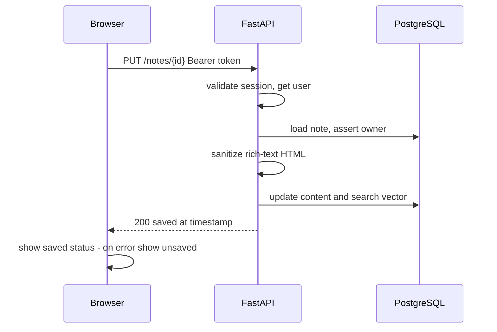
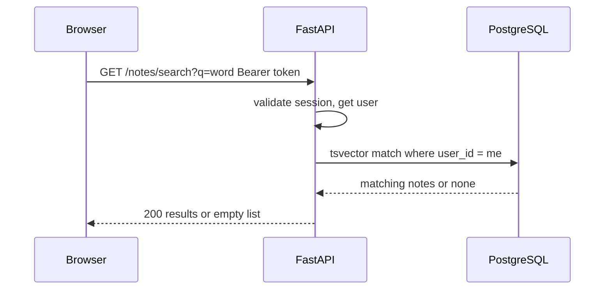
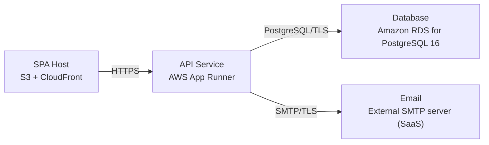

# Architecture

> Maintained by QuorQ AI SDLC. Text between `sdlc:auto` markers is regenerated; anything outside them is yours and is kept.

<!-- sdlc:auto:start narrative -->
## Overview

### ARCH-COMP-web_app · approved · source: architecture:component:web_app

React 19 single-page app providing the responsive UI for sign-in, note list, rich-text editor with autosave status, tag/folder organising, and search.

Stores the opaque session token and sends it as Authorization: Bearer on every API call. Reads the API base URL from VITE_API_BASE_URL.

**Related:** REQ-STACK

### ARCH-COMP-api · approved · source: architecture:component:api

FastAPI 0.115 backend that registers/authenticates users, manages sessions, and enforces per-user note ownership.

Registers and authenticates users, issues and revokes server-side session tokens, enforces that every note read/write/delete is scoped to the owning user, sanitises and stores rich-text content, serves full-text search, manages tags/folders, and sends account emails via SMTP.

**Related:** REQ-STACK, NFR-001, NFR-002, NFR-003, NFR-004

### ARCH-COMP-db · approved · source: architecture:component:db

PostgreSQL 16 database storing all account, note, tag/folder and session data, with built-in full-text search.

Stores accounts, hashed passwords, sessions, notes (owned by exactly one account), tags, folders, and email tokens. Provides built-in full-text search over note title and content via tsvector.

**Related:** REQ-STACK

### ARCH-COMP-email · approved · source: architecture:component:email

External SaaS SMTP service delivering account-verification and password-reset messages.

Delivers account-verification and password-reset messages at personal-use volumes over standard SMTP.

**Related:** REQ-SERVICES

### ARCH-CP-register-signin · approved · source: architecture:critical-path:register-and-sign-in

Describes the register/sign-in flow end to end.

A visitor registers with email and password; the password is hashed, the account is created, a verification email is queued, and an opaque session token is issued and returned in the response body. Sign-in validates credentials and issues a token; failures return a generic message.

**Related:** REQ-FEAT-signin-accounts, NFR-002, NFR-004

### ARCH-CP-autosave · approved · source: architecture:critical-path:autosave-an-edited-note

Describes how autosave works while editing a note.

While the user edits, the SPA debounces changes and PUTs the note content; the backend verifies ownership, sanitises the rich-text HTML, updates the stored content and search vector, and returns a saved status. A failed save surfaces an unsaved state to the user.

**Related:** REQ-FEAT-writing-notes, NFR-005

### ARCH-CP-search · approved · source: architecture:critical-path:search-my-notes

Describes how search across a user's own notes is served.

The signed-in user searches by title or content; the backend runs a PostgreSQL full-text query filtered to the user's own notes and returns matches or a clear empty result.

**Related:** REQ-FEAT-searching-notes, NFR-001

### ARCH-ENTITIES · approved · source: architecture:entities

Data model for the app: users, sessions, email tokens, folders, notes, tags, and note-tag links.

- users: id, email, password_hash, email_verified, created_at
- sessions: id, user_id, token_hash, expires_at, revoked_at, created_at
- email_tokens: id, user_id, token_hash, purpose, expires_at, used_at
- folders: id, user_id, name, created_at
- notes: id, user_id, folder_id, title, content_html, content_text, search_vector, created_at, updated_at
- tags: id, user_id, name
- note_tags: note_id, tag_id

**Related:** ARCH-COMP-db

### ARCH-ENDPOINTS · approved · source: architecture:endpoints

Full REST API surface exposed by the backend, covering auth, notes, folders and tags.

Auth: POST /auth/register (create account, rejects duplicate email/invalid fields, returns session token); POST /auth/login (issue token or generic failure); POST /auth/logout (revoke token); POST /auth/verify-email (confirm via token); POST /auth/password-reset/request (always returns success); POST /auth/password-reset/confirm (set new password via token).
Notes: GET /notes (list with title/snippet, optional folder_id/tag_id filter); POST /notes (create empty note); GET /notes/{id} (open note, refuses other accounts' notes); PUT /notes/{id} (autosave edit, sanitise HTML, update search vector, return saved timestamp); DELETE /notes/{id} (delete owned note); GET /notes/search (full-text search scoped to user, clear empty result).
Folders: GET /folders (list); POST /folders (create); DELETE /folders/{id} (delete, notes become unfiled).
Tags: GET /tags (list); POST /tags (create); PUT /notes/{id}/tags (set tags on a note, scoped to user).

**Related:** ARCH-COMP-api

### ARCH-DEPLOY-spa · approved · source: architecture:deployment-node:SPA Host

Static React 19 build hosted via S3 + CloudFront.

SPA Host (S3 + CloudFront) serves the static React 19 build.

**Related:** ARCH-COMP-web_app

### ARCH-DEPLOY-api · approved · source: architecture:deployment-node:API Service

FastAPI backend runs in a Uvicorn container on AWS App Runner.

API Service (AWS App Runner) runs FastAPI 0.115 on Python 3.12 (Uvicorn container).

**Related:** ARCH-COMP-api

### ARCH-DEPLOY-db · approved · source: architecture:deployment-node:Database

Managed PostgreSQL 16 database via Amazon RDS.

Database node: Amazon RDS for PostgreSQL 16 -- handles backups and patching.

**Related:** ARCH-COMP-db

### ARCH-DEPLOY-email · approved · source: architecture:deployment-node:Email

External SaaS SMTP server used for email delivery.

Email node: External SMTP server (SaaS), communicated with over standard SMTP.

**Related:** ARCH-COMP-email

### ARCH-TECH-frontend · approved · source: architecture:technology-decision:Frontend

React 19 chosen over Vue and Svelte for the frontend.

Builds the responsive SPA with the rich-text editor and live autosave status; served as a static build from S3/CloudFront and talks to the API via a bearer token read from VITE_API_BASE_URL. Alternatives considered: Vue, Svelte.

**Related:** ARCH-COMP-web_app, REQ-STACK

### ARCH-TECH-backend · approved · source: architecture:technology-decision:Backend

FastAPI 0.115 chosen over Flask and Django for the backend.

Lean Python framework handling registration, session issuance/revocation, per-user note scoping, sanitised rich-text storage, and PostgreSQL full-text search without heavy machinery, right-sized for personal scale. Alternatives considered: Flask, Django.

**Related:** ARCH-COMP-api, REQ-STACK

### ARCH-TECH-database · approved · source: architecture:technology-decision:Database

PostgreSQL 16 chosen over MySQL and SQLite for the database.

Stores accounts, notes, tags and folders with a foreign key guaranteeing a note belongs to exactly one account, and serves search via built-in tsvector full-text search, so no separate search engine is needed. Alternatives considered: MySQL, SQLite.

**Related:** ARCH-COMP-db, REQ-STACK

### ARCH-TECH-cloud · approved · source: architecture:technology-decision:Cloud

AWS chosen over GCP and Azure for cloud hosting.

Single-region deployment of the static SPA (S3/CloudFront), the API (App Runner container) and managed PostgreSQL (RDS) that handles backups and patching, scaling down cheaply for a free personal app. Alternatives considered: GCP, Azure.

**Related:** REQ-STACK
<!-- sdlc:auto:end narrative -->

<!-- sdlc:auto:start building-blocks -->
## Building Block View

| ID | Name | Technology | Responsibility | Depends on |
|---|---|---|---|---|
| web_app | React SPA | React 19 | Responsive web UI for sign-in, note list, rich-text editor with autosave status, tag/folder organising, and search. Stores the opaque session token and sends it as Authorization: Bearer on every API call. Reads the API base URL from VITE_API_BASE_URL. | api |
| api | FastAPI Backend | FastAPI 0.115 | Registers and authenticates users, issues and revokes server-side session tokens, enforces that every note read/write/delete is scoped to the owning user, sanitises and stores rich-text content, serves full-text search, manages tags/folders, and sends account emails via SMTP. | db, email |
| db | PostgreSQL Database | PostgreSQL 16 | Stores accounts, hashed passwords, sessions, notes (owned by exactly one account), tags, folders, and email tokens. Provides built-in full-text search over note title and content via tsvector. | — |
| email | SMTP Email Service | SMTP server (SaaS) | Delivers account-verification and password-reset messages at personal-use volumes over standard SMTP. | — |

<!-- sdlc:auto:end building-blocks -->

<!-- sdlc:auto:start runtime -->
## Runtime View

### Register and sign in

A visitor registers with email and password; the password is hashed, the account is created, a verification email is queued, and an opaque session token is issued and returned in the response body. Sign-in validates credentials and issues a token; failures return a generic message.

- **Components:** web_app, api, db, email
- **Modules:** auth_router, auth_service, password_hasher, session_store, email_sender
- **Key functions:** register(email, password), hash_password(password), create_session(user_id), authenticate(email, password), send_verification_email(user)

### Autosave an edited note

While the user edits, the SPA debounces changes and PUTs the note content; the backend verifies ownership, sanitises the rich-text HTML, updates the stored content and search vector, and returns a saved status. A failed save surfaces an unsaved state to the user.

- **Components:** web_app, api, db
- **Modules:** notes_router, notes_service, html_sanitizer, ownership_guard
- **Key functions:** update_note(note_id, user_id, title, content_html), assert_owned(note_id, user_id), sanitize_html(content_html), refresh_search_vector(note)

### Search my notes

The signed-in user searches by title or content; the backend runs a PostgreSQL full-text query filtered to the user's own notes and returns matches or a clear empty result.

- **Components:** web_app, api, db
- **Modules:** search_router, search_service, ownership_guard
- **Key functions:** search_notes(user_id, query), to_tsquery(query)

<!-- sdlc:auto:end runtime -->

<!-- sdlc:auto:start deployment-view -->
## Deployment View

| Name | Service | Runtime | Scaling | Environment |
|---|---|---|---|---|
| SPA Host | S3 + CloudFront | Static React 19 build | CDN edge cache, static | dev |
| API Service | AWS App Runner | FastAPI 0.115 on Python 3.12 (Uvicorn container) | 1 instance, scale-to-few for personal use | dev |
| Database | Amazon RDS for PostgreSQL 16 | PostgreSQL 16 | Single-AZ small instance, automated backups | dev |
| Email | External SMTP server (SaaS) | SMTP | Provider-managed | dev |

| Source | Target | Protocol |
|---|---|---|
| SPA Host | API Service | HTTPS |
| API Service | Database | PostgreSQL/TLS |
| API Service | Email | SMTP/TLS |

<!-- sdlc:auto:end deployment-view -->

<!-- sdlc:auto:start decisions -->
## Architecture Decisions

| Layer | Choice | ADR |
|---|---|---|
| Frontend | React 19 | [ADR-0001](adr/frontend.md) |
| Backend | FastAPI 0.115 | [ADR-0002](adr/backend.md) |
| Database | PostgreSQL 16 | [ADR-0003](adr/database.md) |
| Cloud | AWS | [ADR-0004](adr/cloud.md) |
<!-- sdlc:auto:end decisions -->

<!-- sdlc:auto:start links -->
## Related Documents

- [Data Model](data-model.md)
- [API Specification](api/openapi.yaml)
- [Architecture Decision Records](adr/README.md)
<!-- sdlc:auto:end links -->
