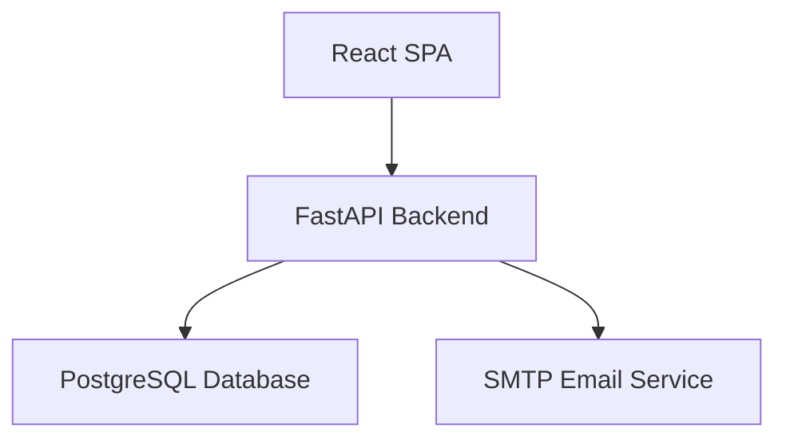
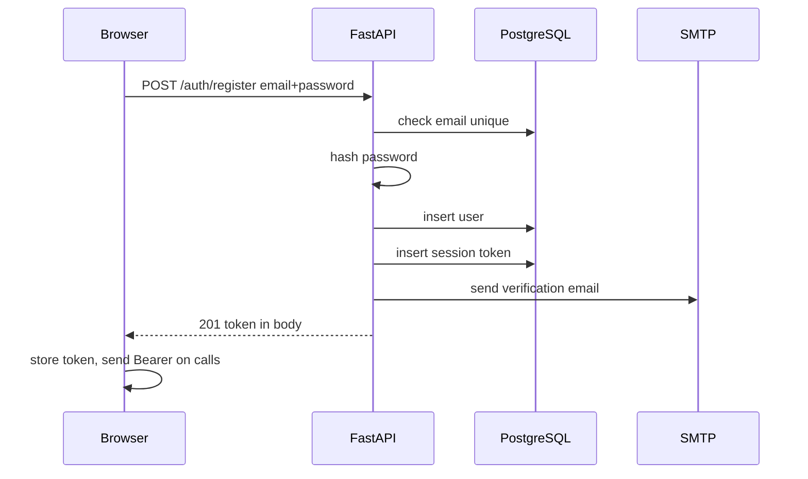
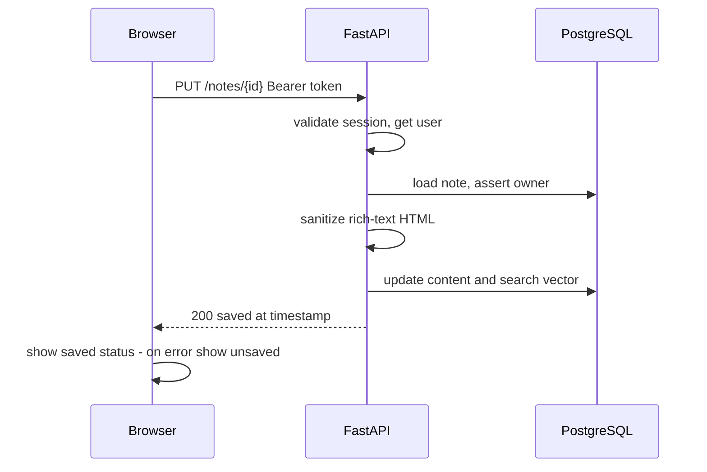
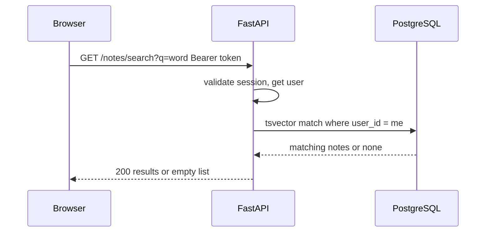
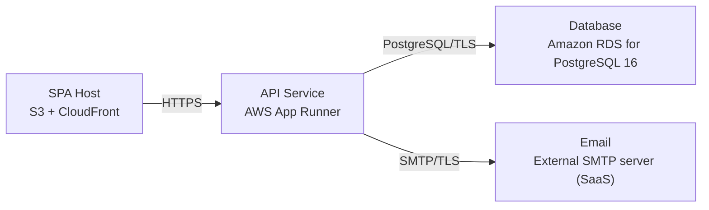

# Architecture

> Maintained by QuorQ AI SDLC. Text between `sdlc:auto` markers is regenerated; anything outside them is yours and is kept.

<!-- sdlc:auto:start narrative -->
## Overview

### ARCH-SUMMARY · approved · source: architecture:summary

A lightweight personal notes web app on the approved stack (React 19 SPA, FastAPI 0.115 backend, PostgreSQL 16, AWS), with server-side opaque bearer-token sessions and PostgreSQL-native full-text search.

Users register and sign in with email and password, keep rich-text notes strictly private to their account, autosave edits, organise notes with tags and folders, and search their own notes. Sessions are server-side with an opaque bearer token because the SPA and API are served from separate origins. PostgreSQL alone covers storage and full-text search; an external SMTP server sends verification and password-reset emails. Everything is sized for modest personal-use scale with managed RDS backups and patching.

### ARCH-COMP-WEB · approved · source: architecture:component:web_app

React SPA providing the responsive UI for sign-in, note list, rich-text editing with autosave status, tag/folder organising, and search.

Stores the opaque session token and sends it as Authorization: Bearer on every API call. Reads the API base URL from VITE_API_BASE_URL.

### ARCH-COMP-API · approved · source: architecture:component:api

FastAPI backend that registers/authenticates users, manages sessions, enforces per-user note ownership, and serves search and tag/folder management.

Registers and authenticates users, issues and revokes server-side session tokens, enforces that every note read/write/delete is scoped to the owning user, sanitises and stores rich-text content, serves full-text search, manages tags/folders, and sends account emails via SMTP.

### ARCH-COMP-DB · approved · source: architecture:component:db

PostgreSQL database storing all accounts, notes, tags, folders, sessions, and email tokens, with built-in full-text search.

Stores accounts, hashed passwords, sessions, notes (owned by exactly one account), tags, folders, and email tokens. Provides built-in full-text search over note title and content via tsvector.

### ARCH-COMP-EMAIL · approved · source: architecture:component:email

External SMTP email service delivering account-verification and password-reset messages.

Delivers account-verification and password-reset messages at personal-use volumes over standard SMTP.

### ARCH-ENTITIES · approved · source: architecture:entities

Data model covers users, sessions, email tokens, folders, notes, tags, and note-tag associations.

- users: id, email, password_hash, email_verified, created_at
- sessions: id, user_id, token_hash, expires_at, revoked_at, created_at
- email_tokens: id, user_id, token_hash, purpose, expires_at, used_at
- folders: id, user_id, name, created_at
- notes: id, user_id, folder_id, title, content_html, content_text, search_vector, created_at, updated_at
- tags: id, user_id, name
- note_tags: note_id, tag_id

### ARCH-ENDPOINTS-AUTH · approved · source: architecture:endpoints:auth

Authentication and account-recovery endpoints.

- POST /auth/register - create account, rejects duplicate email and invalid values, returns an opaque session token.
- POST /auth/login - authenticate and issue an opaque session token in the body; generic error on failure without revealing if the email exists.
- POST /auth/logout - revoke the current session token on the server.
- POST /auth/verify-email - confirm an account using a token from the verification email.
- POST /auth/password-reset/request - request a password-reset email; always returns success to avoid revealing whether the email exists.
- POST /auth/password-reset/confirm - set a new password using a reset token.

### ARCH-ENDPOINTS-NOTES · approved · source: architecture:endpoints:notes

Note CRUD and search endpoints, all scoped to the signed-in user.

- GET /notes - list the signed-in user's notes with title and snippet; optional folder_id or tag_id filter.
- POST /notes - create a new empty note owned by the user, ready for editing.
- GET /notes/{id} - open one of the user's notes with saved content and formatting; refuses notes owned by another account.
- PUT /notes/{id} - autosave an edit; sanitises rich-text HTML, updates content and search vector, returns saved timestamp.
- DELETE /notes/{id} - delete a note the user owns so it no longer appears in list or search.
- GET /notes/search - full-text search across the user's own notes by title or content; clear empty result when nothing matches.

### ARCH-ENDPOINTS-FOLDERS-TAGS · approved · source: architecture:endpoints:folders-tags

Folder and tag management endpoints, scoped to the signed-in user.

- GET /folders - list the user's folders.
- POST /folders - create a folder for the user.
- DELETE /folders/{id} - delete a folder; its notes become unfiled.
- GET /tags - list the user's tags.
- POST /tags - create a tag for the user.
- PUT /notes/{id}/tags - set the tags assigned to a note (add or remove), scoped to the user.

### ARCH-CRITICAL-REGISTER-SIGNIN · approved · source: architecture:critical-path:register-signin

Registration hashes the password, creates the account, queues a verification email, and issues a session token; sign-in validates credentials and issues a token.

A visitor registers with email and password; the password is hashed, the account is created, a verification email is queued, and an opaque session token is issued and returned in the response body. Sign-in validates credentials and issues a token; failures return a generic message.

**Related:** ARCH-COMP-API, ARCH-COMP-DB, ARCH-COMP-EMAIL

### ARCH-CRITICAL-AUTOSAVE · approved · source: architecture:critical-path:autosave

The SPA debounces edits and PUTs note content; the backend verifies ownership, sanitises HTML, updates content and search index, and reports save status.

While the user edits, the SPA debounces changes and PUTs the note content; the backend verifies ownership, sanitises the rich-text HTML, updates the stored content and search vector, and returns a saved status. A failed save surfaces an unsaved state to the user.

**Related:** ARCH-COMP-WEB, ARCH-COMP-API

### ARCH-CRITICAL-SEARCH · approved · source: architecture:critical-path:search

Search runs a PostgreSQL full-text query scoped to the signed-in user's own notes.

The signed-in user searches by title or content; the backend runs a PostgreSQL full-text query filtered to the user's own notes and returns matches or a clear empty result.

**Related:** ARCH-COMP-API, ARCH-COMP-DB

### ARCH-DEPLOYMENT-NODES · approved · source: architecture:deployment-nodes

Planned single-region AWS deployment topology: static SPA host, containerized API service, managed database, and external email.

- SPA Host: S3 + CloudFront serving the static React 19 build.
- API Service: AWS App Runner running FastAPI 0.115 on Python 3.12 (Uvicorn container).
- Database: Amazon RDS for PostgreSQL 16.
- Email: external SMTP server (SaaS).

**Related:** ARCH-COMP-WEB, ARCH-COMP-API, ARCH-COMP-DB, ARCH-COMP-EMAIL

### ARCH-TECH-FRONTEND · approved · source: architecture:technology-decision:frontend

React 19 chosen over Vue/Svelte for the SPA.

Builds the responsive SPA with the rich-text editor and live autosave status; served as a static build from S3/CloudFront and talks to the API via a bearer token read from VITE_API_BASE_URL. Alternatives considered: Vue, Svelte.

**Related:** ARCH-COMP-WEB

### ARCH-TECH-BACKEND · approved · source: architecture:technology-decision:backend

FastAPI 0.115 chosen over Flask/Django for the backend.

Lean Python framework handling registration, session issuance/revocation, per-user note scoping, sanitised rich-text storage, and PostgreSQL full-text search without heavy machinery, right-sized for personal scale. Alternatives considered: Flask, Django.

**Related:** ARCH-COMP-API

### ARCH-TECH-DATABASE · approved · source: architecture:technology-decision:database

PostgreSQL 16 chosen over MySQL/SQLite for storage and search.

Stores accounts, notes, tags and folders with a foreign key guaranteeing a note belongs to exactly one account, and serves search via built-in tsvector full-text search, so no separate search engine is needed. Alternatives considered: MySQL, SQLite.

**Related:** ARCH-COMP-DB

### ARCH-TECH-CLOUD · approved · source: architecture:technology-decision:cloud

AWS chosen over GCP/Azure for hosting.

Single-region deployment of the static SPA (S3/CloudFront), the API (App Runner container) and managed PostgreSQL (RDS) that handles backups and patching, scaling down cheaply for a free personal app. Alternatives considered: GCP, Azure.

**Related:** ARCH-DEPLOYMENT-NODES
<!-- sdlc:auto:end narrative -->

<!-- sdlc:auto:start building-blocks -->
## Building Block View

| ID | Name | Technology | Responsibility | Depends on |
|---|---|---|---|---|
| web_app | React SPA | React 19 | Responsive web UI for sign-in, note list, rich-text editor with autosave status, tag/folder organising, and search. Stores the opaque session token and sends it as Authorization: Bearer on every API call. Reads the API base URL from VITE_API_BASE_URL. | api |
| api | FastAPI Backend | FastAPI 0.115 | Registers and authenticates users, issues and revokes server-side session tokens, enforces that every note read/write/delete is scoped to the owning user, sanitises and stores rich-text content, serves full-text search, manages tags/folders, and sends account emails via SMTP. | db, email |
| db | PostgreSQL Database | PostgreSQL 16 | Stores accounts, hashed passwords, sessions, notes (owned by exactly one account), tags, folders, and email tokens. Provides built-in full-text search over note title and content via tsvector. | — |
| email | SMTP Email Service | SMTP server (SaaS) | Delivers account-verification and password-reset messages at personal-use volumes over standard SMTP. | — |

<!-- sdlc:auto:end building-blocks -->

<!-- sdlc:auto:start runtime -->
## Runtime View

### Register and sign in

A visitor registers with email and password; the password is hashed, the account is created, a verification email is queued, and an opaque session token is issued and returned in the response body. Sign-in validates credentials and issues a token; failures return a generic message.

- **Components:** web_app, api, db, email
- **Modules:** auth_router, auth_service, password_hasher, session_store, email_sender
- **Key functions:** register(email, password), hash_password(password), create_session(user_id), authenticate(email, password), send_verification_email(user)

### Autosave an edited note

While the user edits, the SPA debounces changes and PUTs the note content; the backend verifies ownership, sanitises the rich-text HTML, updates the stored content and search vector, and returns a saved status. A failed save surfaces an unsaved state to the user.

- **Components:** web_app, api, db
- **Modules:** notes_router, notes_service, html_sanitizer, ownership_guard
- **Key functions:** update_note(note_id, user_id, title, content_html), assert_owned(note_id, user_id), sanitize_html(content_html), refresh_search_vector(note)

### Search my notes

The signed-in user searches by title or content; the backend runs a PostgreSQL full-text query filtered to the user's own notes and returns matches or a clear empty result.

- **Components:** web_app, api, db
- **Modules:** search_router, search_service, ownership_guard
- **Key functions:** search_notes(user_id, query), to_tsquery(query)

<!-- sdlc:auto:end runtime -->

<!-- sdlc:auto:start deployment-view -->
## Deployment View

| Name | Service | Runtime | Scaling | Environment |
|---|---|---|---|---|
| SPA Host | S3 + CloudFront | Static React 19 build | CDN edge cache, static | dev |
| API Service | AWS App Runner | FastAPI 0.115 on Python 3.12 (Uvicorn container) | 1 instance, scale-to-few for personal use | dev |
| Database | Amazon RDS for PostgreSQL 16 | PostgreSQL 16 | Single-AZ small instance, automated backups | dev |
| Email | External SMTP server (SaaS) | SMTP | Provider-managed | dev |

| Source | Target | Protocol |
|---|---|---|
| SPA Host | API Service | HTTPS |
| API Service | Database | PostgreSQL/TLS |
| API Service | Email | SMTP/TLS |

<!-- sdlc:auto:end deployment-view -->

<!-- sdlc:auto:start decisions -->
## Architecture Decisions

| Layer | Choice | ADR |
|---|---|---|
| Frontend | React 19 | [ADR-0001](adr/frontend.md) |
| Backend | FastAPI 0.115 | [ADR-0002](adr/backend.md) |
| Database | PostgreSQL 16 | [ADR-0003](adr/database.md) |
| Cloud | AWS | [ADR-0004](adr/cloud.md) |
<!-- sdlc:auto:end decisions -->

<!-- sdlc:auto:start links -->
## Related Documents

- [Data Model](data-model.md)
- [API Specification](api/openapi.yaml)
- [Architecture Decision Records](adr/README.md)
<!-- sdlc:auto:end links -->
