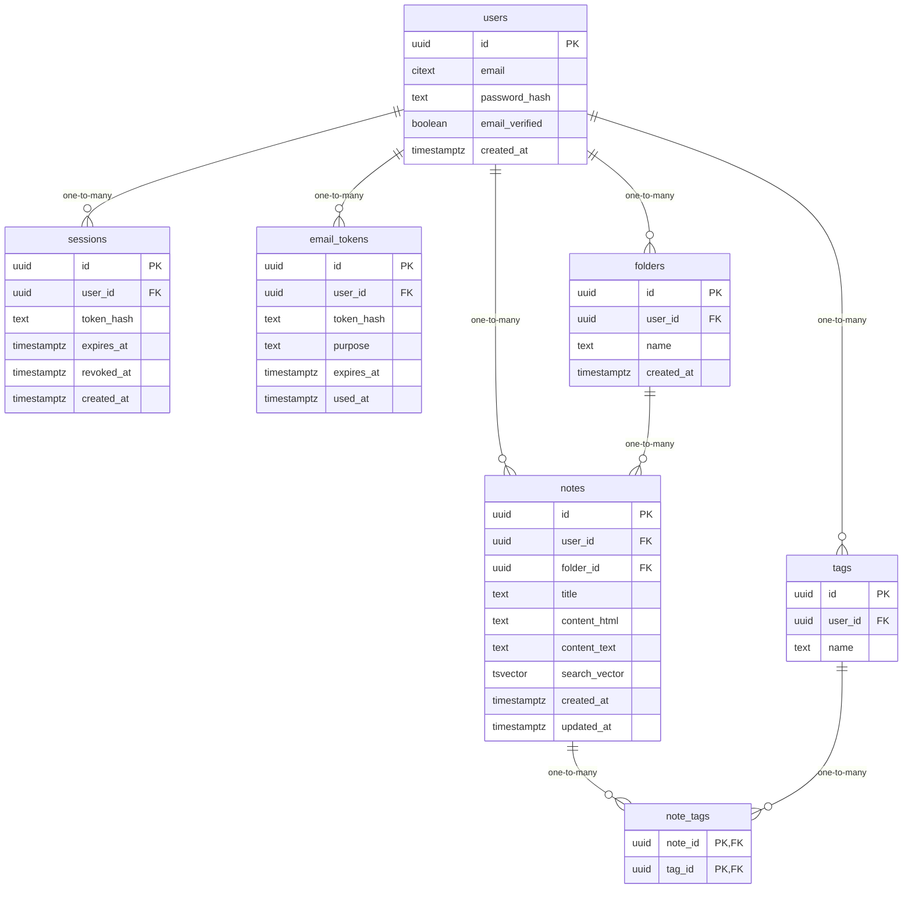

# Data Model

<!-- sdlc:auto:start entities -->
### users

| Field | Type | PK | FK | Nullable |
|---|---|---|---|---|
| id | uuid | True | — | False |
| email | citext | False | — | False |
| password_hash | text | False | — | False |
| email_verified | boolean | False | — | False |
| created_at | timestamptz | False | — | False |

### sessions

| Field | Type | PK | FK | Nullable |
|---|---|---|---|---|
| id | uuid | True | — | False |
| user_id | uuid | False | users.id | False |
| token_hash | text | False | — | False |
| expires_at | timestamptz | False | — | False |
| revoked_at | timestamptz | False | — | True |
| created_at | timestamptz | False | — | False |

### email_tokens

| Field | Type | PK | FK | Nullable |
|---|---|---|---|---|
| id | uuid | True | — | False |
| user_id | uuid | False | users.id | False |
| token_hash | text | False | — | False |
| purpose | text | False | — | False |
| expires_at | timestamptz | False | — | False |
| used_at | timestamptz | False | — | True |

### folders

| Field | Type | PK | FK | Nullable |
|---|---|---|---|---|
| id | uuid | True | — | False |
| user_id | uuid | False | users.id | False |
| name | text | False | — | False |
| created_at | timestamptz | False | — | False |

### notes

| Field | Type | PK | FK | Nullable |
|---|---|---|---|---|
| id | uuid | True | — | False |
| user_id | uuid | False | users.id | False |
| folder_id | uuid | False | folders.id | True |
| title | text | False | — | False |
| content_html | text | False | — | False |
| content_text | text | False | — | False |
| search_vector | tsvector | False | — | True |
| created_at | timestamptz | False | — | False |
| updated_at | timestamptz | False | — | False |

### tags

| Field | Type | PK | FK | Nullable |
|---|---|---|---|---|
| id | uuid | True | — | False |
| user_id | uuid | False | users.id | False |
| name | text | False | — | False |

### note_tags

| Field | Type | PK | FK | Nullable |
|---|---|---|---|---|
| note_id | uuid | True | notes.id | False |
| tag_id | uuid | True | tags.id | False |
<!-- sdlc:auto:end entities -->

<!-- sdlc:auto:start relationships -->
| Source | Target | Type |
|---|---|---|
| users | notes | one-to-many |
| users | folders | one-to-many |
| users | tags | one-to-many |
| users | sessions | one-to-many |
| users | email_tokens | one-to-many |
| folders | notes | one-to-many |
| notes | note_tags | one-to-many |
| tags | note_tags | one-to-many |
<!-- sdlc:auto:end relationships -->

<!-- sdlc:auto:start er-diagram -->

<!-- sdlc:auto:end er-diagram -->
